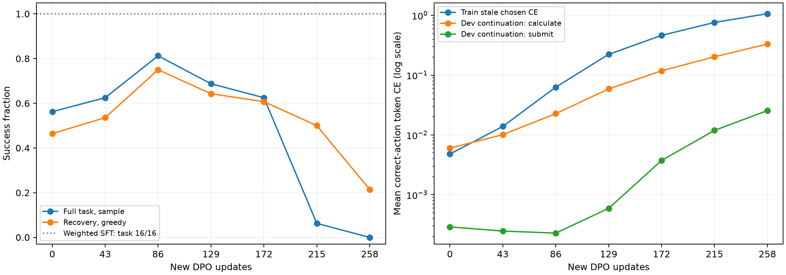

# E1：DPO 退化检查点复核

2026-11-04，Asia/Shanghai。运行：dpo-regression-checkpoints-v1-20261103。

E1 已完成并通过记录复核。训练呈现早期改善、后期大幅退化：86 步时随机完整任务 13/16、贪心完整恢复 21/28；258 步分别为 0/16、6/28。正确动作的损伤从局部场景开始，随后扩展到计算、检查和提交。C1 维持 failed_pending_causal_experiments，GRPO 暂缓；下一项执行 E2 全 1 权重对照。

## 同一轮结果

| 模型 | 完整任务 greedy | 完整任务 sample | 完整恢复 greedy | stale 恢复 greedy | 训练 stale chosen CE |
|---|---:|---:|---:|---:|---:|
| 父模型 | 4/4 | 9/16 | 13/28 | 4/4 | 0.004793 |
| 加权 SFT | 4/4 | 16/16 | 21/28 | 4/4 | 0.004521 |
| 43 步 DPO | 4/4 | 10/16 | 15/28 | 4/4 | 0.013903 |
| 86 步 DPO | 4/4 | 13/16 | 21/28 | 2/4 | 0.062915 |
| 129 步 DPO | 4/4 | 11/16 | 18/28 | 2/4 | 0.222884 |
| 172 步 DPO | 3/4 | 10/16 | 17/28 | 2/4 | 0.462522 |
| 215 步 DPO | 4/4 | 1/16 | 14/28 | 2/4 | 0.760977 |
| 258 步 DPO | 0/4 | 0/16 | 6/28 | 0/4 | 1.065367 |

完整任务随机采样为 4 个 development 任务各 4 次，恢复为 4 任务 × 7 场景。重复 rollout 按任务共享问题身份，主表列原始计数。E1 恢复仅使用 greedy。

相对当轮父模型，首次观察到完整任务 greedy 回落在 172 步，随机完整任务回落在 215 步，完整恢复总数回落在 258 步。总体曲线中存在波动，例如 215 步 greedy 完整任务回到 4/4；随机成功和动作 CE 揭示了该阶段已经积累的损伤。

86 步的恢复总数与加权 SFT 同为 21/28，随机完整任务为 13/16 对 16/16，stale 恢复为 2/4 对 4/4。中间检查点保持诊断用途，未晋升候选。

## 退化发生在哪里

1. **stale-evidence 最先暴露保真损伤。** 训练 stale chosen CE 从父模型约 0.004793，在 43 步升至 0.013903，86 步 0.062915，258 步 1.065367，约为父模型 222 倍。stale 自由续跑 greedy 成功在 86 步由 4/4 降至 2/4，最终降至 0/4。
2. **查询与后续动作出现分化。** development 专家恢复续跑中，正确查询 CE 从父模型 0.039740 降至最终 0.006027；计算 CE 从 0.006024 升至 0.331039，检查从 0.004077 升至 0.104441，提交从 0.000290 升至 0.025549。CE 是固定正确文本逐 token 平均负 logp，再按动作取平均；越大代表该正确动作的平均 token 似然越低。
3. **自由生成走向重复查询和预算耗尽。** 随机完整任务中，86 步 query_sql/submit 次数为 50/13；215 步 100/1；258 步 112/0，16 条轨迹共用满 192 轮，成功 0/16。该模式与之前 development-002 的最小决策重放一致：已有两个月的查询证据后，继续查询而未完成计算链。
4. **相对 DPO 目标与正确动作保真分开变化。** 原加权训练的偏好 margin 主要通过压低 rejected 增长；E1 进一步定位到 stale 正确动作概率从早期便下降。整体 chosen CE 在 86 步仍优于父模型，局部损伤已出现，后期才拖累整体与终局成功。

E1 支持“继续更新会放大损伤”的解释。下一项 E2 固定同样 6 遍、258 步，把困难权重 4 改为 1，量化权重的作用；随后按已确认顺序检验 chosen CE 保真项与完整续跑覆盖。

## 本地复核证据

- ZIP CRC、路径、原始归档 SHA256：fd309f32afcff73d00191f12f81db751dc08cf1eef2d12527128b99e1f480bb2。
- 冻结源码 96 份、溯源文件 24 份、8 个检查点身份匹配。三个最终 adapter 本地有真实权重；五个中间 adapter 的实际文件哈希由云端 prepare 核对，返回的完成元数据与此前审阅记录一致。
- 严格重放完整任务 160 条、完整恢复 224 条、首动作 224 个，共 2,692 环境步骤；重新执行 calendar SQL 终局证据补查，汇总和 CSV 一致。
- 8 × 169 对原始逐 token 分数重算 loss/margin/CE；8 × 238 专家探针重算分组 CE。父模型新评分与缓存最大差为 0。跨系统数学库的最大浮点末位差为 1.11e-16，本地仅对浮点指标采用 abs/rel 1e-12；身份、轨迹与错误文本逐字段严格比较。
- SQLite 3.53.1。云端总耗时 8,263.37 秒（约 2 小时 18 分），prepare/scores/evaluate/audit 全部退出 0。E1 新训练更新数为 0，test 未使用。

同一最终 DPO 权重在旧补验为完整任务 greedy 1/4、本次为 0/4；父模型随机完整任务旧 8/16、本次 9/16。E1 采用 max_loras=8，旧补验为 4。权重身份一致，历史评测按各自运行记录保留，本报告的阶段比较使用 E1 同轮结果。

## Jupyter 响应慢的日志线索

本包的四个阶段正常完成，日志中未见 OOM/killed；评分峰值已分配显存约 6.10 GiB。vLLM 日志列出可用 GPU KV cache 23.03 GiB，另有 FlashInfer 缺失后使用原生采样的提示。现有包没有主机 RAM、swap、磁盘 I/O 与 Jupyter 服务状态采样；这些将作为 E2 的只读资源快照记录。E2 保持训练与采样参数，按阶段记录 nvidia-smi、free、df、ps，便于关联资源占用和页面卡顿。

## 下一项已冻结：E2

新运行 dpo-uniform-control-v1-20261104：chosen-only 父模型与 frozen reference、169 对、6 遍 258 更新、fresh Adam、LR 5e-6、beta 0.1、batch 4、max norm 1、seed 2026110301 保持原值。唯一训练字段变化为 hard_weight：4 → 1，归一化后 169 个权重全部为 1。

同轮评测父模型、加权 SFT、原加权 DPO、新均匀 DPO。每模型完整任务 20 条、完整恢复 112 条，总计 528 条；四模型各评分 169 对与同一 238 个专家探针。主要比较为均匀 DPO 对原加权 DPO 的终局成功、完整恢复、stale CE、计算/检查/提交 CE、有效首动作到最终成功的转换。E2 准备包由本地验证后交付，GPU 结果等待云端执行。
