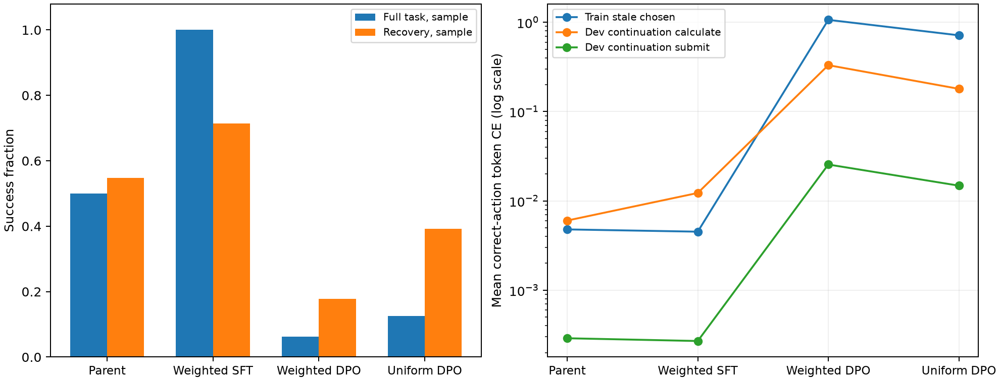

# E2 均匀权重 DPO：结果复核与审计修复

2026-11-04，Asia/Shanghai。运行 dpo-uniform-control-v1-20261104。

训练、评测与补审计均已通过复核。补审计耗时 32.83 秒，208 份原返回文件逐一一致，新增训练和生成均为 0。原审计的数值门槛报错及修复过程保留在下文。C1 保持未通过，GRPO 暂缓。

## 结果

| 模型 | 完整任务 greedy | 完整任务 sample | 完整恢复 greedy | 完整恢复 sample |
|---|---:|---:|---:|---:|
| 父模型 | 4/4 | 8/16 | 15/28 | 46/84 |
| 加权 SFT | 4/4 | 16/16 | 21/28 | 60/84 |
| 原加权 DPO | 1/4 | 1/16 | 7/28 | 15/84 |
| 均匀 DPO | 3/4 | 2/16 | 15/28 | 33/84 |

本表全部取自 E2 同轮推理。完整任务为 4 个 development 任务各 greedy 1 次、sample 4 次；完整恢复为 4×7 上下文各 greedy 1 次、sample 3 次。样本按任务共享问题身份，主表列原始计数。E2 新训练仅一支均匀 DPO，另外三个模型是冻结推理控制。

均匀 DPO 相对原加权 DPO，随机完整恢复配对改善 19 条、退化 1 条，共同成功 14 条、共同失败 50 条；随机完整任务改善 2 条、退化 1 条，共同成功 0 条、共同失败 13 条。完整恢复由 15/84 增至 33/84，完整任务仍为 2/16，低于父模型 8/16 与加权 SFT 16/16。

## 动作保真与续跑

训练 stale chosen CE：父模型 0.004793，原加权 DPO 1.065365，均匀 DPO 0.714917。均匀分支较加权下降约 32.9%，仍约为父模型 149 倍。

development 专家恢复续跑的正确动作 token CE：

| 动作 | 父模型 | 原加权 DPO | 均匀 DPO |
|---|---:|---:|---:|
| calculate_change | 0.006024 | 0.331038 | 0.179872 |
| check_result | 0.004077 | 0.104442 | 0.059215 |
| submit | 0.000290 | 0.025549 | 0.014816 |

均匀分支计算、检查与提交的损伤减轻，仍明显偏离父模型。随机恢复首动作有效数：加权 54/84、均匀 48/84；这些有效首动作最终成功数分别为 13/54（24.1%）和 23/48（47.9%）。第一步有效性与完整续跑表现继续分开报告。另有首动作判为无效、随后恢复成功的加权 2 条、均匀 10 条。

这组结果将排查重点推进到正确动作保真：全 1 权重分支仍退化，后续 E3 检查加权 DPO 加入 chosen CE 后的变化，E4 再检查专家完整续跑覆盖。

## 原报错的具体原因

原审计条件为 original_difference > 1e-4。27,940 个对齐 token 中，只有 1 个超过该绝对门槛：样本索引 93（第 94 对）、rejected token 索引 0，本次 -3.8380355834960938，历史 -3.838167428970337，绝对差 0.00013184547424316406。

两份 reference 的父 adapter、pair IDs、input IDs、长度和 tokenizer 一致。本次评分阶段重新计算父 reference，与本次训练缓存逐项完全相同，最大差为 0。跨次数据的整体差异为：

- 平均逐 token 绝对差 5.7741e-7。
- 最大整段 logp 求和差 0.000198793。
- 最大 reference chosen−rejected margin 差 0.000209966。
- beta=0.1 时，任意当前策略的逐对 DPO loss 差异上界 0.000020997；四个已保存策略实际最大 loss 差约 0.000010498。

上界来自 softplus 的 1-Lipschitz 性质：reference margin 差乘 beta，界定对应未加权逐对 DPO loss 的变化。它量化此处参考数值的目标影响；模型训练的硬件变化另列在下面。

## 修复策略

新增 cross_run_fp32_reference_v1 联合检查：保留 token 绝对容差 1e-4，加入相对容差 5e-5；额外约束最大 token 绝对差 ≤5e-4、平均 token 差 ≤1e-5、整段求和差 ≤5e-4、DPO logit 差 ≤5e-5。模型身份、pair/input ID、长度、有限非正概率均严格核验。本次同轮 reference 复算检查继续沿用原条件。

原始 source、reference、训练和轨迹文件保留。新入口重新检查真实 Adam state、258 次更新、checkpoint、4×169 对评分、4×238 探针和全部完整轨迹，生成 reference_numerics_audit.json 与 audit.json。原 run_status.json 保留第一次失败；补跑完成状态记录在 audit_repair_status.json。

训练源码和计算记录采用原冻结快照，补丁源码保存到独立 audit_repair_source。修复 runner 对原 ZIP 和所有原产物进行哈希绑定与前后校验；新增训练和生成更新均为 0。

## 执行环境与对照范围

本次资源日志记录 GPU 为 NVIDIA L40S（49,140 MiB）；前期项目交接记录为 L20。训练算法配置的变化为 hard_weight 4→1，当前硬件记录与前期登记不同。硬件一致性列为复验项；后续固定同一硬件，补齐权重独立效应的对照。

后续 E3 在同机安排纯加权 DPO 控制与 DPO+chosen CE 分支，直接复用一份已哈希冻结的 reference 缓存，在首个更新前完成核验；这同时补齐 E2 的同硬件权重对照。本次审计补跑已完成；下一项按同硬件与精确reference协议冻结。

阶段边界 free 记录宿主机 available 约 887–896 GiB、swap 0；这些快照未包含容器 cgroup 配额或卡顿瞬间 I/O。当前报错明确发生在数值审计条件，训练和推理各阶段退出 0。

## 复核证据

原包 SHA256：d79d8632c364a23a97587948f82c6b1538fb9e1b2daca7f5ef6ed7375aeed07c。CRC 与路径检查通过。

本地核对 103 份冻结源码、30 份溯源、4 个真实 adapter 和 tokenizer；验证全 1 权重、258 更新、1,014 对曝光和 reference 文件绑定。原云端审计已执行 Adam state 与更新检查后，才停在跨次 reference 门槛；真实 state.pt 留在云端，由补跑再次验证。

重算 4×169 偏好和 4×238 专家探针；严格重放 80 条完整任务、448 条完整恢复、448 个首动作，共 3,202 个生成动作步骤，固定恢复前缀在各次重放中另行复原；重算 calendar SQL 与汇总。SQLite 3.53.1；浮点统计重算最大末位差 1.11e-16，使用 abs/rel 1e-12；身份和轨迹逐字段严格匹配。test 未使用。

原作业总时长 10,880.58 秒，约 3 小时 1 分；prepare/train/scores/complete/recovery 全部退出 0，audit 退出 1。补审计于本轮完成：audit_repair_status.json 为 exit_code=0、error=null，audit.json 为 passed=true；本地再次核对派生统计、calendar 与 CSV 一致。补审计回包 SHA256：1392f4bce45f14b74d407ace78f4bdf854d59906116647aa13f9c8c44d9794b4。
